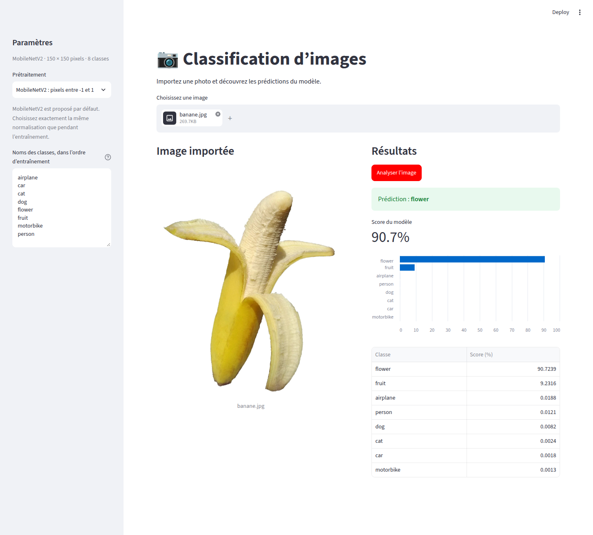

# Classification d’images avec Streamlit

Deux applications de classification d’images avec TensorFlow/Keras :

- `app.py` : MobileNetV2, images RGB et huit classes (`airplane`, `car`, `cat`, `dog`, `flower`, `fruit`, `motorbike`, `person`). Configuration, poids et noms des classes dans `model/`.
- `main.py` : CNN pour les fruits (`Apple`, `Banana`, `Orange`), modèle `CNN_fruits.h5`. Le notebook `CNN_classification_fruits_Lab.ipynb` contient l’entraînement ; le jeu de données `fruits/` est à fournir séparément.

## Installation et lancement

Python 3.12 a été utilisé pour les essais.

```bash
python3 -m venv .venv
source .venv/bin/activate
python -m pip install -r requirements.txt
python -m streamlit run app.py
```

Pour l’application dédiée aux fruits :

```bash
python -m streamlit run main.py
```

Dans l’application principale, importer une image puis cliquer sur **Analyser l’image**. Le prétraitement MobileNetV2 (pixels entre -1 et 1) est sélectionné par défaut. Les noms des classes et le prétraitement doivent correspondre à l’entraînement.

## Captures des essais

Les captures dans [`docs/screenshots/`](docs/screenshots/) proviennent d’essais réels dans Chrome, le 3 novembre 2026. Les images de chat, chien, voiture et pommes viennent du dossier Téléchargements ; la nouvelle photo de banane vient de Wikimedia Commons. Les scores affichés sont ceux du modèle et ne constituent pas une mesure de précision sur un jeu de test.


| Image | Prédiction | Score du modèle |
| --- | --- | --- |
| Chat | cat | 98,7 % |
| Chien | dog | 100,0 % |
| Voiture | car | 100,0 % |
| Pommes | fruit | 61,8 % |
| Banane (nouvelle photo) | flower (incorrect) | 90,7 % |

### Chat


### Chien


### Voiture


### Pommes


### Banane — nouvel essai



La précédente capture des bananes a été remplacée par cet essai sur une autre photo, sans modification du modèle ni du prétraitement MobileNetV2. Catégorie attendue : `fruit` ; prédiction obtenue : `flower` (90,7 %).

Photo téléchargée : [Banana on whitebackground.jpg](https://commons.wikimedia.org/wiki/File:Banana_on_whitebackground.jpg), par Filo gèn', sous licence [CC BY-SA 4.0](https://creativecommons.org/licenses/by-sa/4.0/). Le fichier original est conservé sans modification dans [`docs/test-images/banane.jpg`](docs/test-images/banane.jpg). La photo reproduite dans la capture reste sous cette licence.

Ces cinq essais concernent `app.py`. Le nouvel essai de banane illustre une erreur du modèle malgré un score élevé ; un score élevé ne garantit donc pas une bonne classification.

Les prédictions et scores sont enregistrés dans [`results.json`](docs/screenshots/results.json).
